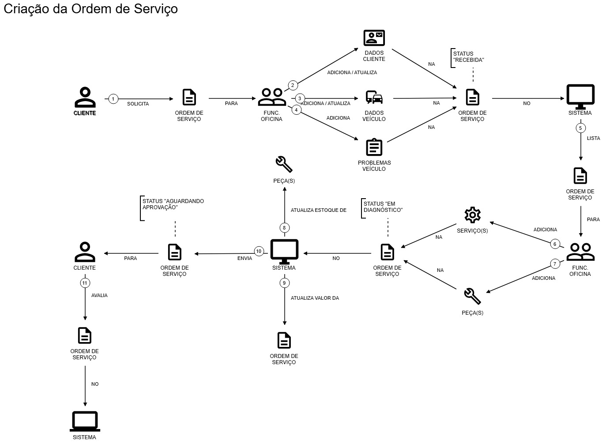
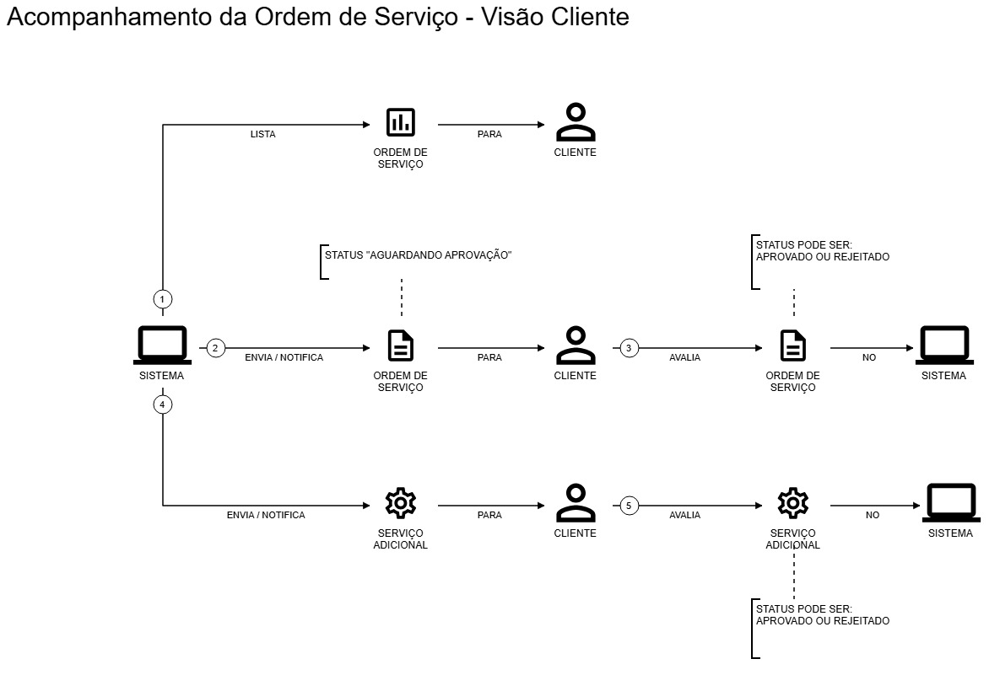
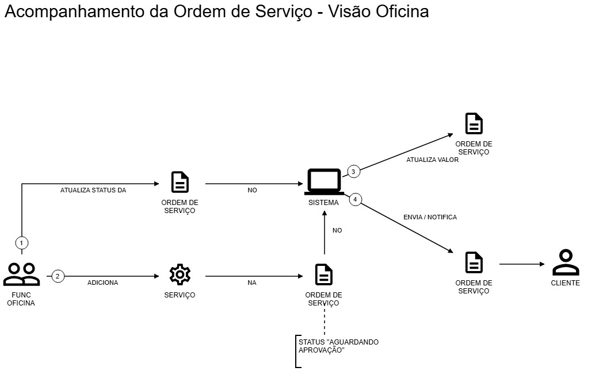
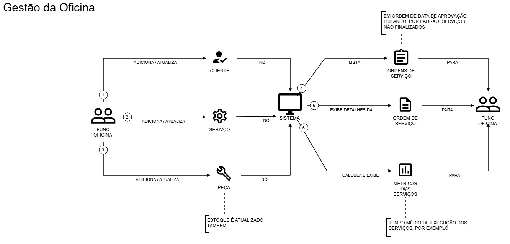
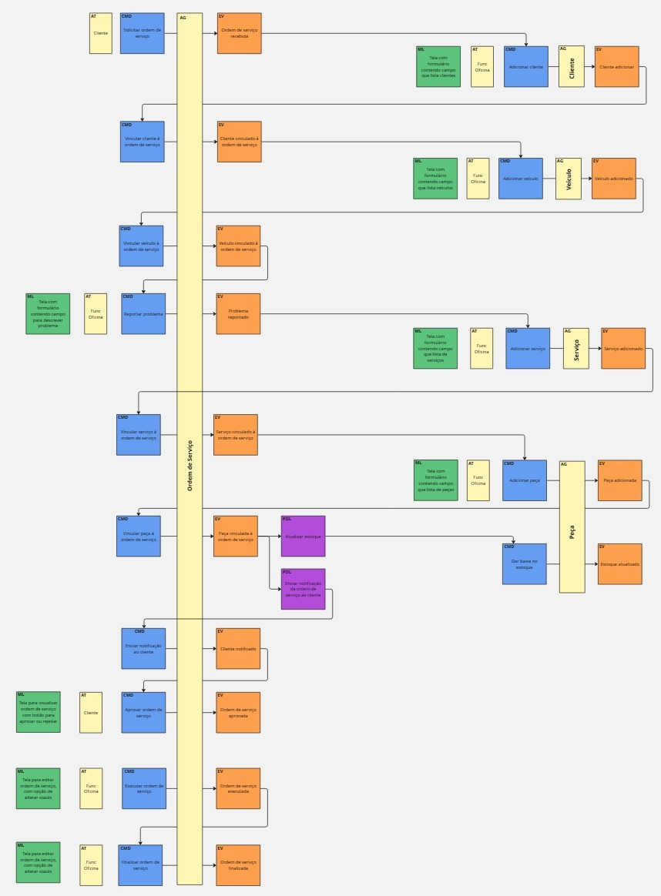

# Oficina Mecanica API

MVP em C# para o Tech Challenge da oficina mecanica. A solucao usa um monolito em camadas com foco em ordens de servico, clientes, veiculos, catalogo de servicos, pecas, estoque, autenticacao e metricas operacionais.

## Time

- Lucas Rodrigues Camargo
- Graziella Garcia Camargo

## DDD

### Dicionario ubiquo

Este projeto usa os seguintes termos de dominio como linguagem comum entre codigo, API e documentacao:

- Cliente: pessoa fisica ou juridica atendida pela oficina, identificada por CPF ou CNPJ.
- Veiculo: automovel vinculado a um cliente, identificado principalmente pela placa.
- Ordem de servico ou OS: registro do atendimento realizado pela oficina para um cliente e veiculo.
- Numero da OS: identificador publico da ordem, gerado no formato `OS-...`, usado na consulta publica.
- Solicitacao do cliente: lista de relatos informados no recebimento da OS, como barulho, vazamento ou falha percebida.
- Diagnostico: etapa em que a oficina inicia a avaliacao tecnica do problema informado.
- Catalogo de servicos: lista de servicos que podem compor o orcamento de uma OS.
- Peca: item de estoque usado na execucao de uma OS, com SKU, preco unitario e quantidade disponivel.
- Reserva de estoque: baixa temporaria da quantidade de pecas quando um orcamento e montado.
- Orcamento: conjunto de servicos e pecas sugeridos para resolver a OS, com valor total.
- Itens adicionais: servicos ou pecas incluidos depois do orcamento inicial e enviados para nova aprovacao.
- Aprovacao: decisao do cliente sobre o orcamento; quando aprovado, a OS entra em execucao.
- Reprovacao: decisao do cliente recusando o orcamento; as pecas reservadas retornam ao estoque.
- Execucao: etapa em que a oficina realiza os servicos aprovados.
- Finalizacao: conclusao tecnica do servico antes da entrega ao cliente.
- Entrega: etapa final em que o veiculo e devolvido ao cliente.
- Metricas de execucao: indicadores de tempo total e tempo entre etapas da OS.

### Linguagem pictografica

#### Criacao da ordem de servico



#### Ordem de servico - cliente



#### Ordem de servico - oficina



#### Gestao da oficina



## Event Storming



## Stack

- ASP.NET Core Web API (.NET 10)
- Entity Framework Core com PostgreSQL
- ASP.NET Identity para usuarios e roles
- JWT Bearer para endpoints protegidos
- Swagger/OpenAPI com descricoes e tipos de response
- xUnit para testes unitarios e de integracao
- Docker Compose para API, PostgreSQL e SonarQube
- SonarQube Community para relatorios de qualidade, vulnerabilidades, security hotspots e code smells

## Features

- Login com JWT em `POST /api/auth/login`
- Cadastro de usuarios em `POST /api/auth/register`
- Seed inicial com usuario admin, roles, cliente, veiculo, servicos e peca
- CRUD de clientes
- CRUD de veiculos
- CRUD do catalogo de servicos
- CRUD de pecas com controle de estoque
- Tabelas e colunas no padrao `snake_case` com prefixo `tb_`
- Tabelas do Identity sem prefixo `asp_net`
- Criacao de ordem de servico com status inicial `Received`
- Solicitacoes do cliente salvas como lista de strings em `customer_request`
- Inicio de diagnostico com `diagnosticStartedAtUtc`
- Inclusao posterior de servicos e pecas no orcamento
- Reserva de estoque ao montar o orcamento
- Envio para aprovacao com status `WaitingApproval`
- Endpoint de aprovacao/reprovacao do orcamento
- Reprovacao com status `Reproved` e devolucao de pecas ao estoque
- Cancelamento permitido apenas em `Received`, `InDiagnosis` e `WaitingApproval`
- Status salvo no banco como string do enum
- Alteracao de status por numero do enum para `Finished` e `Delivered`
- Consulta publica da ordem por numero e documento do cliente
- Metricas gerais de tempo de execucao
- Metricas por ordem com tempo total e tempo entre etapas
- Swagger documentado com summaries, descriptions e response types
- Suite de testes com cobertura de dominio, aplicacao, controllers, auth, seed e integracao

## Credenciais iniciais

- Usuario: `admin`
- Senha: `Admin@123`

As credenciais ficam persistidas no banco via Identity, com senha armazenada em hash.

## Principais endpoints

### Auth

- `POST /api/auth/register`: cadastra um novo usuario da API e define se ele sera admin.
- `POST /api/auth/login`: autentica um usuario e retorna um token JWT para acessar endpoints protegidos.

### Clientes, veiculos, servicos e pecas

- `GET /api/customers`: lista os clientes cadastrados.
- `GET /api/customers/{id}`: consulta os dados de um cliente pelo identificador.
- `POST /api/customers`: cria um cliente com CPF ou CNPJ valido.
- `PUT /api/customers/{id}`: atualiza os dados cadastrais de um cliente.
- `DELETE /api/customers/{id}`: remove um cliente existente.
- `GET /api/vehicles`: lista os veiculos cadastrados com seus respectivos clientes.
- `GET /api/vehicles/{id}`: consulta um veiculo pelo identificador.
- `POST /api/vehicles`: cria um veiculo vinculado a um cliente.
- `PUT /api/vehicles/{id}`: atualiza placa, marca, modelo ou ano de um veiculo.
- `DELETE /api/vehicles/{id}`: remove um veiculo existente.
- `GET /api/services`: lista os servicos disponiveis no catalogo da oficina.
- `GET /api/services/{id}`: consulta um servico do catalogo pelo identificador.
- `POST /api/services`: cria um servico com nome, descricao, preco e horas estimadas.
- `PUT /api/services/{id}`: atualiza os dados de um servico do catalogo.
- `DELETE /api/services/{id}`: remove um servico do catalogo.
- `GET /api/parts`: lista as pecas em estoque.
- `GET /api/parts/{id}`: consulta uma peca pelo identificador.
- `POST /api/parts`: cria uma peca com SKU, preco unitario e quantidade inicial.
- `PUT /api/parts/{id}`: atualiza dados, preco ou quantidade em estoque de uma peca.
- `DELETE /api/parts/{id}`: remove uma peca existente.

### Ordens de servico

- `GET /api/service-orders`: lista todas as ordens de servico com cliente, veiculo, itens e status.
- `GET /api/service-orders/{id}`: consulta os detalhes completos de uma OS pelo identificador.
- `POST /api/service-orders`: cria uma OS recebida a partir do documento do cliente, veiculo e solicitacoes.
- `POST /api/service-orders/{id}/diagnosis/start`: inicia o diagnostico e muda a OS para `InDiagnosis`.
- `PATCH /api/service-orders/{id}/budget`: adiciona servicos e pecas ao orcamento, reserva estoque e envia para aprovacao.
- `PATCH /api/service-orders/{id}/budget/additional-items`: adiciona itens extras ao orcamento e gera nova aprovacao.
- `POST /api/service-orders/{id}/approval`: aprova ou reprova o orcamento informado.
- `POST /api/service-orders/{id}/cancel`: cancela uma OS quando o status ainda permite cancelamento.
- `POST /api/service-orders/{id}/status`: altera a OS para `Finished` ou `Delivered`.
- `GET /api/service-orders/public/{number}?document=...`: consulta publica da OS pelo numero e documento do cliente.
- `GET /api/service-orders/metrics/execution-time`: retorna metricas gerais de tempo de execucao das OS finalizadas.
- `GET /api/service-orders/{id}/metrics/execution-time`: retorna a linha do tempo e tempos entre etapas de uma OS.

## Criacao de ordem de servico

```json
{
  "customerDocument": "12345678901",
  "vehicle": {
    "plate": "BRA2E19",
    "brand": "Volkswagen",
    "model": "Gol",
    "year": 2020
  },
  "customerRequest": [
    "Customer reports engine noise.",
    "Customer reports oil leak."
  ]
}
```

Depois, o orcamento pode ser adicionado com:

```json
{
  "serviceIds": [
    "2677042f-aba1-405f-a465-68665a683169"
  ],
  "parts": [
    {
      "partId": "c9aeadbf-cb28-49c5-a47b-63328764c36c",
      "quantity": 1
    }
  ]
}
```

## Status da ordem

```csharp
Received = 1
InDiagnosis = 2
WaitingApproval = 3
InExecution = 4
Finished = 5
Delivered = 6
Reproved = 7
Canceled = 8
```

O endpoint `POST /api/service-orders/{id}/status` recebe o numero do enum e permite somente `5` (`Finished`) e `6` (`Delivered`):

```json
{
  "status": 5
}
```

## Swagger

Com a API rodando:

- Swagger UI: `http://localhost:8080/swagger`
- OpenAPI JSON: `http://localhost:8080/openapi/v1.json`

A documentacao inclui:

- Summary de cada endpoint em ingles
- Description de cada endpoint em ingles
- Tipos de response
- Status codes esperados como `200`, `201`, `204`, `400`, `401`, `404` e `409`
- Configuracao Bearer para colar o token JWT

## Collections de requests

A pasta `request-collections/` contem exemplos de requests da aplicacao para facilitar testes manuais em clients HTTP. Os arquivos foram gerados em formato compativel com Thunder Client, mas tambem servem como referencia para montar ou adaptar as chamadas em outros clients, como Postman, Insomnia ou Bruno.

- Collection: `request-collections/oficina-mecanica-api-requests.collection.json`
- Environment local: `request-collections/oficina-mecanica-local.environment.json`

O environment usa `baseUrl=http://localhost:5240`, porta padrao do `dotnet run`. Para testar a API via Docker, altere `baseUrl` para `http://localhost:8080`. Depois de executar `POST /api/auth/login`, copie o `accessToken` retornado para a variavel `token` antes de chamar endpoints protegidos.

## Como rodar localmente

```bash
dotnet restore
dotnet build
dotnet run --project OficinaMecanica.Api
```

Por padrao, a API espera PostgreSQL em `localhost:5432`.

Connection string local padrao:

```text
Host=localhost;Port=5432;Database=oficina_mecanica;Username=postgres;Password=postgres
```

## Como rodar com Docker

Subir todos os servicos:

```bash
docker compose up --build -d
```

Servicos:

- API: `http://localhost:8080`
- Swagger: `http://localhost:8080/swagger`
- PostgreSQL: `localhost:5432`
- SonarQube: `http://localhost:9000`

Parar os containers:

```bash
docker compose down
```

Parar e remover os dados do banco e do SonarQube:

```bash
docker compose down -v
```

## SonarQube

O `docker-compose.yml` inclui o SonarQube Community para gerar relatorios de qualidade, vulnerabilidades, security hotspots, bugs e code smells.

Subir somente PostgreSQL e SonarQube:

```bash
docker compose up -d postgres sonarqube
```

Acessar:

```text
http://localhost:9000
```

Credenciais iniciais padrao do SonarQube:

- Usuario: `admin`
- Senha: `admin`

No primeiro login, o SonarQube solicita a troca da senha. Depois crie um token em:

```text
My Account > Security > Generate Tokens
```

Instalar o scanner .NET:

```bash
dotnet tool install --global dotnet-sonarscanner
```

Executar analise:

```bash
dotnet sonarscanner begin /k:"oficina-mecanica" /d:sonar.host.url="http://localhost:9000" /d:sonar.token="<SEU_TOKEN>"
dotnet build
dotnet test
dotnet sonarscanner end /d:sonar.token="<SEU_TOKEN>"
```

Depois da execucao, o relatorio fica disponivel no painel do SonarQube em:

```text
http://localhost:9000/dashboard?id=oficina-mecanica
```

Observacao: em alguns ambientes Linux, o SonarQube pode exigir ajuste de `vm.max_map_count`. Para uso local via Docker Compose, foi configurado `SONAR_ES_BOOTSTRAP_CHECKS_DISABLE=true`.

## Como testar

```bash
dotnet test
```

Resultado esperado atual:

```text
Aprovado! - Com falha: 0, Aprovado: 37, Total: 37
```

## Fluxo sugerido para demonstracao

1. Subir a stack com `docker compose up --build -d`.
2. Abrir o Swagger em `http://localhost:8080/swagger`.
3. Fazer login em `POST /api/auth/login` com o admin inicial.
4. Clicar em `Authorize` no Swagger e informar `Bearer <token>`.
5. Consultar clientes, veiculos, servicos e pecas semeados.
6. Criar uma ordem de servico com `POST /api/service-orders`.
7. Iniciar diagnostico com `POST /api/service-orders/{id}/diagnosis/start`.
8. Adicionar orcamento com `PATCH /api/service-orders/{id}/budget`.
9. Aprovar ou reprovar com `POST /api/service-orders/{id}/approval`.
10. Finalizar e entregar com `POST /api/service-orders/{id}/status`.
11. Consultar metricas gerais ou por id.
12. Consultar a OS pelo endpoint publico.
13. Rodar a analise no SonarQube para verificar vulnerabilidades e qualidade.
