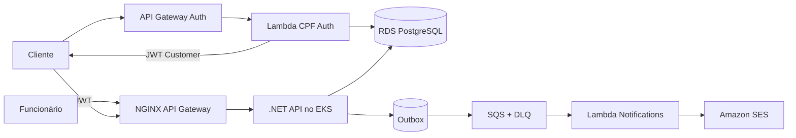
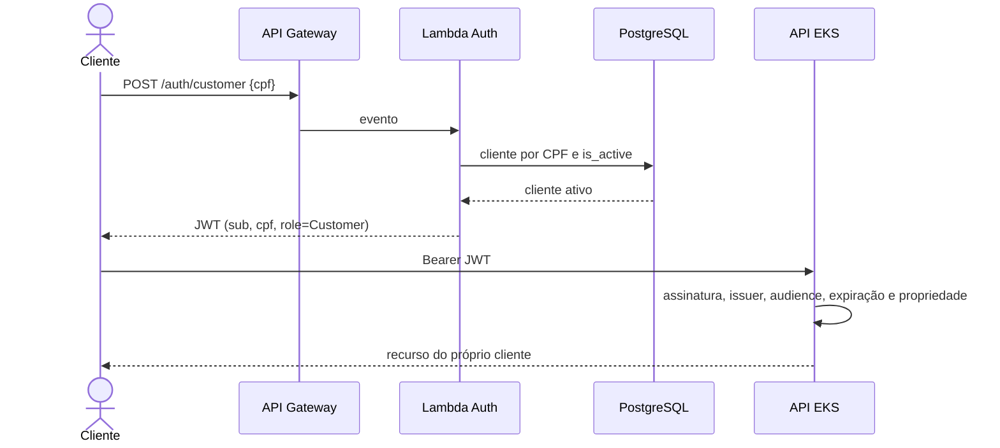
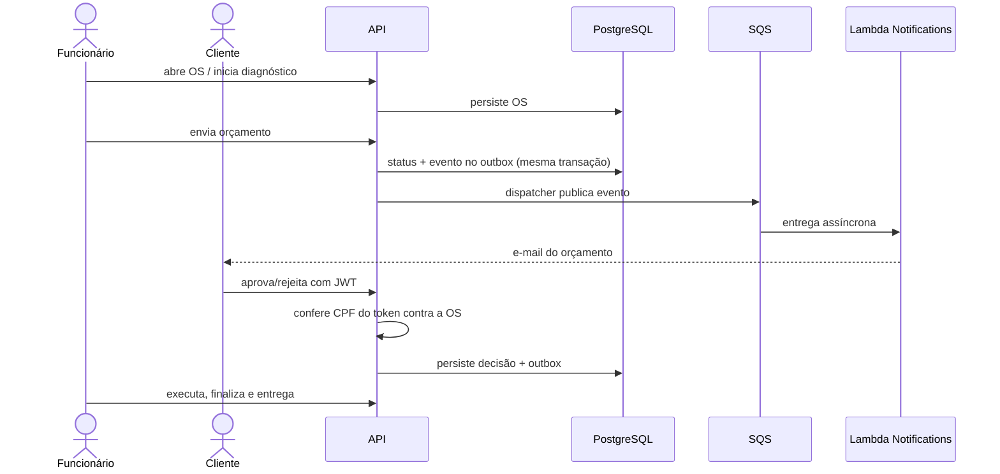

# Arquitetura — Fase 3

## Visão de componentes

## Sequência de autenticação do cliente

## Sequência da ordem de serviço

## Repositórios locais

| Responsabilidade | Pasta |
|---|---|
| Aplicação e manifests Kubernetes | `pos-tech-fiap-software-architecture` |
| Funções Auth e Notifications | `pos-tech-fiap-software-architecture-serverless` |
| VPC, EKS, add-ons e ECR | `pos-tech-fiap-software-architecture-kubernetes-infra` |
| RDS, segredo e migrations | `pos-tech-fiap-software-architecture-database-infra` |

As URLs Git serão adicionadas depois da criação dos quatro repositórios remotos.
